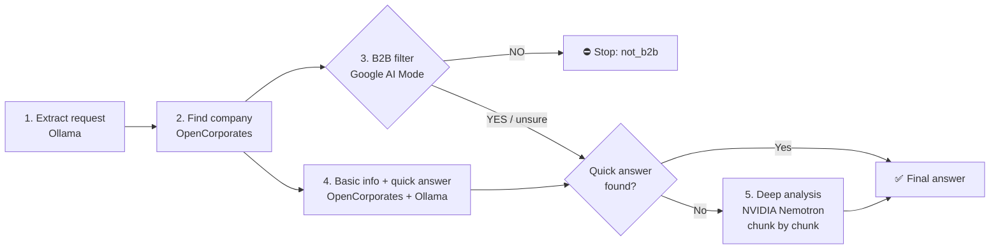

# 🤖 B2B Company Extraction & Qualification Agent — Luxembourg
 
> A multi-agent AI pipeline that understands a natural-language question about a Luxembourg company, finds it in the official registry, checks whether it is **B2B**, and answers the question, digging into the company's full official history when needed.
 
Internship project — **INPT × 3LM Solutions, Tunisia**
**Author:** Mohamed EL HARCHALI · **Supervisor / Project Lead:** Saidi Souhir
 
---
 
## 📌 Table of Contents
 
- [Context](#-context)
- [How it works](#-how-it-works)
- [Tech stack](#-tech-stack)
- [Repository structure](#-repository-structure)
- [Getting started](#-getting-started)
- [Usage](#-usage)
- [Example results](#-example-results)
- [Output format](#-output-format)
- [Observability with LangSmith](#-observability-with-langsmith)
- [Known limitations](#-known-limitations)
- [Roadmap](#-roadmap)
- [What I learned](#-what-i-learned)
- [Acknowledgements](#-acknowledgements)
---
 
## 🎯 Context
 
Companies registered in Luxembourg need to be qualified quickly: *which of them operate in B2B, and what can we learn about them?* Doing this by hand is:
 
| Problem | Description |
|---|---|
| 🐢 **Manual & slow** | One-by-one company research |
| 🧩 **Scattered data** | Registries, statuses, official statements |
| 🎯 **Need** | An automated, traceable and reliable agent |
 
This project answers that need with a pipeline that chains several LLMs and external APIs, and stops early (saving cost) when a company is not relevant.
 
---
 
## ⚙️ How it works
 
The agent runs a **6-step pipeline**:
 

 
| # | Step | Tool | Description |
|---|------|------|-------------|
| 1 | **Request extraction** | Ollama (`gpt-oss:120b`) | Reads the user's question and extracts `query`, `company_name` and `company_number` (if provided) as JSON. |
| 2 | **Company lookup** | OpenCorporates API | Searches the Luxembourg registry (`jurisdiction_code=lu`) by name and retrieves the official company number (RCS). |
| 3 | **B2B filter** | Google AI Mode (via SerpApi) | Asks the web whether the company is B2B (partial B2B tolerated). `NO` → the pipeline stops. |
| 4 | **Basic info + quick answer** | OpenCorporates + Ollama | Runs *in parallel* with step 3. Fetches type, status, incorporation date… and tries to answer from these alone. |
| 5 | **Deep analysis** | NVIDIA Nemotron | If the quick answer fails, the company's official statements are split into chunks and read one at a time. The model decides on its own whether to `continue` or return `final`. |
| 6 | **Final answer** | Python orchestration | Returns a structured JSON with status, answer and source. |
 
### Design highlights
 
- **Parallel execution** — B2B check and basic-info retrieval run concurrently via `ThreadPoolExecutor`.
- **Early stopping** — clearly B2C companies are rejected immediately, no unnecessary LLM calls.
- **Fail-open on ambiguity** — if the B2B answer is ambiguous or the call fails, the company is *not* rejected.
- **Iterative reasoning** — the Nemotron agent keeps a running `state` across chunks, which scales to companies with a long history.
- **Robust JSON parsing** — markdown fences added by LLMs are stripped before parsing, with safe fallbacks.
- **Full traceability** — every step is traced in LangSmith.
---
 
## 🧰 Tech stack
 
| Tool | Role |
|---|---|
| 🦙 **Ollama** (`gpt-oss:120b-cloud`) | Request understanding + quick answer |
| 🏢 **OpenCorporates API** | Official company registry data (Luxembourg) |
| 🔍 **Google AI Mode** (via **SerpApi**) | B2B / B2C qualification |
| ⚡ **NVIDIA Nemotron** (`nvidia/nemotron-3-ultra-550b-a55b`) | Deep, iterative analysis of statements |
| 📊 **LangSmith** | Tracing and debugging |
| 🐍 **Python** | `requests`, `beautifulsoup4`, `openai`, `ollama`, `serpapi`, `langsmith` |
 
---
 
## 📁 Repository structure
 
```
.
├── agent_ia_b2b_luxembourg.ipynb    # Full pipeline (Google Colab notebook)
├── Rapport_de_stage_Agent_IA_B2B_Luxembourg.pdf   # Internship report (French)
├── requirements.txt
└── README.md
```
 
---
 
## 🚀 Getting started
 
### Prerequisites
 
You need API keys for:
 
| Service | Where to get it |
|---|---|
| OpenCorporates | https://opencorporates.com/api_accounts/new |
| Ollama (cloud) | https://ollama.com |
| SerpApi | https://serpapi.com |
| NVIDIA API Catalog | https://build.nvidia.com |
| LangSmith | https://smith.langchain.com |
 
### Run on Google Colab (recommended)
 
1. Open [`agent_ia_b2b_luxembourg.ipynb`](agent_ia_b2b_luxembourg.ipynb) in [Google Colab](https://colab.research.google.com/).
2. Open the **🔑 Secrets** tab and add the following secrets (enable notebook access for each):
   | Secret name | Service |
   |---|---|
   | `Open` | OpenCorporates token |
   | `OLLAMA` | Ollama API key |
   | `SERPAPI_API_KEY` | SerpApi key |
   | `NVIDIA` | NVIDIA API key |
   | `LANGSMITH` | LangSmith API key |
3. Run the install cell, then all remaining cells.
```bash
pip install -q langsmith openai ollama google-search-results beautifulsoup4 requests
```
 
> 🔐 **Security:** keys are loaded through `google.colab.userdata`. **No API key is stored in the code** — never commit your keys to the repository.
 
### Run locally (optional)
 
The notebook imports `google.colab.userdata`. To run it outside Colab, replace those calls with environment variables, for example:
 
```python
import os
OPENCORPORATES_TOKEN = os.environ["OPENCORPORATES_TOKEN"]
OLLAMA_API_KEY       = os.environ["OLLAMA_API_KEY"]
SERPAPI_KEY          = os.environ["SERPAPI_API_KEY"]
NVIDIA_KEY           = os.environ["NVIDIA_API_KEY"]
os.environ["LANGSMITH_API_KEY"] = os.environ["LANGSMITH_API_KEY"]
```
 
---
 
## 💻 Usage
 
```python
import json
 
result = process_client_request(
    "y a t elle une date ou EUROPEAN FUND FOR ENERGY n'accepte plus d'investisseurs?"
)
print(json.dumps(result, ensure_ascii=False, indent=2))
```
 
You can ask in natural language, with a company name or directly with its RCS number.
 
---
 
## 🧪 Example results
 
### ✅ Case 1 — Successful answer: *EUROPEAN FUND FOR ENERGY*
 
**Question:** *Is there a date after which the fund no longer accepts investors?*
 
The company is B2B, the basic info is not enough → the deep analysis reads the 3 statement chunks and returns a sourced answer.
 
```json
{
  "status": "answered",
  "company_number": "B149221",
  "answer": "Yes, the fund's Articles establish a 'Final Closing' concept — the date after which no additional investors may be admitted ...",
  "source": "get_statements_comp",
  "chunks_used": 3,
  "total_chunks": 3
}
```
 
### ⛔ Case 2 — Filtered out: *BALKAN FOOD SARL*
 
**Question:** *Who is the director of BALKAN FOOD SARL?*
 
The company is identified as B2C (restaurant) → the pipeline stops immediately.
 
```json
{
  "status": "not_b2b",
  "company_number": "B145446",
  "message": "Cette entreprise n'est pas B2B, nous ne pouvons pas traiter cette demande."
}
```
 
---
 
## 📦 Output format
 
`process_client_request()` always returns a dictionary with a `status`:
 
| `status` | Meaning | Main fields |
|---|---|---|
| `answered` | Answer found | `company_number`, `answer`, `source` (`get_info_comp` or `get_statements_comp`), `chunks_used`, `total_chunks` |
| `not_b2b` | Company is clearly not B2B, processing stopped | `company_number`, `message` |
| `not_found` | Company found but no answer in the available data | `company_number`, `message` |
| `error` | Company could not be identified from the request | `message` |
 
---
 
## 📊 Observability with LangSmith
 
Every step is decorated with `@traceable` and logged to LangSmith (default project name: `other_one`, configurable in the config cell). You can inspect inputs/outputs, latency and the chunk-by-chunk reasoning of the Nemotron agent.
 
Traced functions include: `extract_request`, `get_search_comp` / `search_comp`, `is_b2b` / `call_serpapi`, `fetch_info_and_try_answer` / `get_info_comp` / `try_answer_from_basic_info`, `get_statements_comp` / `fetch_statements` / `chunk_list` / `call_nvidia_llm_json`.
 
---
 
## ⚠️ Known limitations
 
- **Data coverage stops in 2016.** OpenCorporates statements for Luxembourg come from the *Mémorial* (official gazette). On the tested cases, the latest indexed publication dates from **2016** (`gazette_notice_delegate`, 2016-03-23). Any question about a later fact cannot be answered by this pipeline.
- **First-match company resolution.** When searching by name, the first OpenCorporates result is used (the full list is returned internally but not yet disambiguated).
- **B2B check relies on a web AI answer.** Google AI Mode output is parsed for `OUI`/`NON`; ambiguous answers let the company through.
- **Colab-oriented setup.** The notebook uses Colab secrets by default.
---
 
## 🛣️ Roadmap
 
- [ ] Disambiguation when several companies match a name
- [ ] Additional / more recent data sources beyond the Mémorial
- [ ] Extract the notebook into a proper Python package + CLI / REST API
- [ ] Caching of OpenCorporates and SerpApi calls
- [ ] Automated evaluation set (question → expected answer)
---
 
## 🎓 What I learned
 
- Orchestrating **several LLMs** (Ollama, SerpApi/Google AI Mode, NVIDIA) inside a single agent
- Using a **real business API** (OpenCorporates) for company data
- **Tracing and debugging** a full pipeline with LangSmith
- Designing **iterative, chunk-by-chunk reasoning** to process large volumes of data
---
 
## Acknowledgements
 
Thanks to **3LM Solutions** and my supervisor **Saidi Souhir** for the opportunity, the choice of this subject and the time dedicated to this internship, and to **INPT** for the academic framework.
 
---
